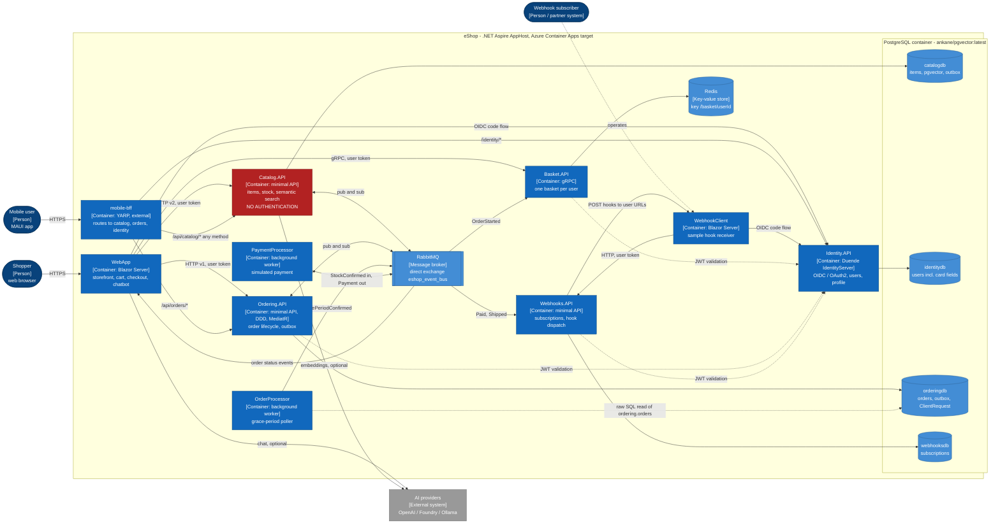
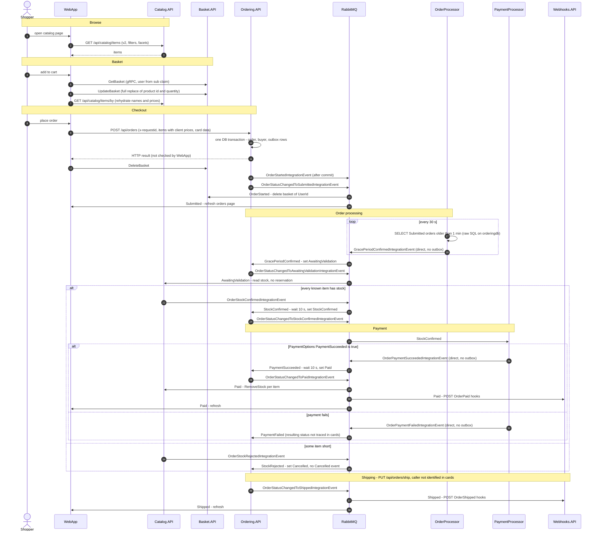
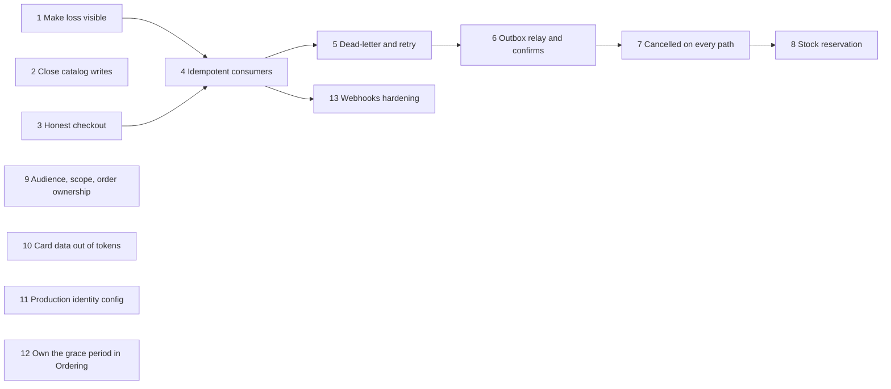

# eShop architecture overview

- Verified at commit: d9aa12b
- Inputs: explorer cards in `docs/architecture/services/` (CAT, BAS, ORD, PRC, IDN, WHK, WEB, PLT) and `docs/architecture/themes/` (EVT, SEC).
- Claim IDs in brackets point to those cards. Claims added by this overview use the `[ARCH-NN]` prefix and carry their own evidence (section 0).
- Out of scope, as in the cards: `src/ClientApp` and `src/HybridApp`.

## 0. Architect claims and card reconciliation

Code was opened only to settle disagreements between cards.

- [ARCH-01] The mobile BFF has a catch-all route `/api/catalog/{*any}` that matches only on the `api-version` query value and has no HTTP method restriction. POST, PUT and DELETE therefore reach Catalog.API's anonymous write endpoints through the BFF's external endpoint. Evidence: `src/eShop.AppHost/Extensions.cs:141-143`. This settles CAT-07, which listed only the `/catalog-api/...` read routes (`src/eShop.AppHost/Extensions.cs:97-139`), against PLT-02, which also listed `/api/catalog/*`.
- [ARCH-02] The Paid command handler also waits 10 s (`Task.Delay(10000)`) before it loads the order. Evidence: `src/Ordering.API/Application/Commands/SetPaidOrderStatusCommandHandler.cs:21-22`. This confirms EVT-50. ORD-29 named only the stock-confirmed handler.
- [ARCH-03] An idempotent wrapper, `SetPaidIdentifiedOrderStatusCommandHandler`, already exists (a duplicate returns `true`). The integration-event path sends the plain command instead (EVT-41). Evidence: `src/Ordering.API/Application/Commands/SetPaidOrderStatusCommandHandler.cs:36-50`.
- Still open: the connection name is `eventbus` in some services and `EventBus` in others (EVT-22, PRC-13). It is not ranked, because all participants run in one AppHost topology with a single `eventbus` resource (PLT-14).

## 1. Context and containers

Notes on the diagram:
- The topology and data stores come from PLT-05, PLT-06 and PLT-14. The BFF routes come from PLT-02 and ARCH-01.
- Client calls: WebApp (WEB-12, WEB-13, WEB-14, WEB-16, WEB-17) and WebhookClient (WHK-23, WHK-24).
- Event wiring: EVT-09 to EVT-19.
- Shared-database read by OrderProcessor: EVT-08.
- Catalog is red because it has no authentication (SEC-04).
- Every user call between services carries the user's forwarded access token. No service-level credentials are used (SEC-16). The workers run without any identity (SEC-18).
- Identity publishes and handles no events (EVT-21).

## 2. Main business flow: browse, basket, checkout, order processing, payment

Evidence for the flow:
- Browse and basket: WEB-19, WEB-06, BAS-05, WEB-24.
- Checkout: WEB-23, ORD-04, ORD-16, EVT-24, EVT-25, EVT-26, WEB-22, EVT-09, EVT-10.
- Grace period: PRC-15, PRC-19, EVT-11, EVT-12.
- Stock: EVT-13, CAT-29.
- Payment: EVT-14, EVT-15, PRC-24, ORD-29, ARCH-02.
- Paid fan-out: EVT-16.
- Stock-rejected path: EVT-54.
- Shipping: EVT-17 and the open question in the EVT card.
- Nothing orchestrates the saga. Each step is a reaction to the previous event (EVT-20).

## 3. Top 5 weak spots

| # | Weak spot | Severity | Key claims |
|---|---|---|---|
| 1 | Integration events can be lost silently at every hop | High | EVT-28, EVT-29, EVT-30, EVT-32, EVT-35, EVT-48 |
| 2 | Stock is not reserved, and decrements are neither safe nor idempotent | High | EVT-52, EVT-37, EVT-42, EVT-53, EVT-54 |
| 3 | Catalog writes are public, and API authorization is too coarse | High | SEC-04, ARCH-01, SEC-31, SEC-22, ORD-28 |
| 4 | Card data sits in tokens, and identity uses development credentials | High | IDN-23, SEC-37, ORD-33, SEC-25, IDN-25 |
| 5 | Checkout can fail silently and lose the basket | Medium | WEB-22, EVT-46, ORD-27, EVT-51 |

### 3.1 Integration events can be lost silently at every hop (High)

What it is:
- Publish side: Ordering and Catalog write outbox rows atomically with the business change (EVT-24, EVT-27). Nothing relays them, though. A failed publish only marks the row PublishedFailed. The pending query is keyed by the current TransactionId and has a single caller, so a crash between commit and publish leaves a NotPublished row that is never sent (EVT-28, PLT-13, ORD-26, CAT-28).
- A row is marked Published as soon as `PublishAsync` returns. There are no publisher confirms, so an unroutable message goes undetected (EVT-29).
- OrderProcessor and PaymentProcessor publish directly, with no outbox (EVT-30, PRC-11).
- Consume side: when a handler throws, the error is logged and the message is acked anyway. There is no dead-letter exchange and no consumer retry (EVT-32, PLT-21). Later handlers for the same event are skipped (EVT-33). Unknown event types are dropped and acked (EVT-34).
- If the broker connection is not open at startup, the consumer returns silently and the host keeps running without consuming (EVT-35, PLT-23).
- A message body that contains `throw-fake-exception` deliberately throws in the production consumer path (EVT-36, PLT-22).

Why it matters:
- The saga is pure choreography with no orchestrator and no timeouts (EVT-20). A lost event leaves an order stuck in its current status, and no log entry at the domain level shows it (EVT-48).
- Only the Submitted step is re-driven, by OrderProcessor polling (EVT-40). No other step has a re-drive.
- Concrete example: if Catalog's Paid handler throws, the decrement for the whole order is lost and never retried (EVT-37).
- No envelope field supports tracing or reconciliation after the fact. Events carry no correlation ID or sequence number (EVT-03).

### 3.2 Stock is not reserved, and decrements are neither safe nor idempotent (High)

What it is:
- Catalog confirms stock by reading `AvailableStock` without reserving it. The decrement happens only after payment (EVT-52, CAT-29).
- Two concurrent orders for the last units can both be confirmed and paid. `RemoveStock` then quietly removes less than was ordered (EVT-52).
- `RemoveStock` throws when stock is 0. That aborts the decrement for the whole order, and because failures are acked the decrement is lost (EVT-37, CAT-30, EVT-32).
- A redelivered Paid event decrements again, because Catalog keeps no record of which orders it has processed (EVT-42, EVT-39).
- On redelivery, the stock-validation handler emits a new event with a new ID, so downstream services cannot deduplicate it (EVT-31).
- Products unknown to Catalog are skipped, so an order containing them can be confirmed (EVT-53, CAT-31).
- A cancellation caused by rejected stock raises no domain event, so no Cancelled integration event is published on that path (EVT-54, ORD-30).

Why it matters:
- Orders can be confirmed and paid for goods that do not exist (EVT-52, EVT-53).
- Stock drifts in both directions: too high when a decrement is lost (EVT-37), too low when one is duplicated (EVT-42).
- Without a Cancelled event on every cancellation path, no future reservation can be released reliably (EVT-54).

### 3.3 Catalog writes are public, and API authorization is too coarse (High)

What it is:
- Catalog.API has no authentication or authorization code at all (SEC-04, CAT-06), and that includes POST, PUT and DELETE on items (CAT-05, CAT-27, SEC-32).
- Those write methods are reachable from outside through the mobile BFF's catch-all route (ARCH-01, PLT-02). The BFF does no authentication of its own (SEC-09).
- Shared JWT validation sets `ValidateAudience=false` and applies no scope policy. `AddAuthorization()` is called without options, so any valid token issued by Identity, for any client, is accepted by every API (SEC-20, SEC-22, SEC-31, PLT-27).
- `GET /api/orders/{orderId}` loads an order by ID without checking that it belongs to the caller (ORD-28, SEC-13).
- `RequireHttpsMetadata=false` is set on the JWT bearer handler and on the OIDC clients (SEC-33).

Why it matters:
- Anyone who can reach the BFF can change prices and delete items (ARCH-01, CAT-05).
- A price change flows into new orders, because the order stores the price the WebApp read from Catalog (EVT-55, WEB-06). It also emits ProductPriceChanged (CAT-15).
- Any signed-in user can read other users' orders by enumerating integer IDs (ORD-28). Orders contain the delivery address (ORD-11).
- A token issued to a low-trust client, such as an Implicit-flow Swagger UI (IDN-09, IDN-28), works against every API (SEC-31).

### 3.4 Card data sits in tokens, and identity uses development credentials (High)

What it is:
- Card number, CVV and expiry are stored as plain properties on `ApplicationUser` (IDN-12, IDN-23).
- `ProfileService` copies them into token claims. For `maui`, `webapp` and `webhooksclient` they also go into the ID token (IDN-22, IDN-23, SEC-37).
- Card number and CVV travel through `CreateOrderCommand` into the Order and into `OrderStartedDomainEvent`. Only the number is masked, and only in the API layer (ORD-33, ORD-05).
- WebApp checkout sends hard-coded card data (WEB-21).
- The OIDC client secret `"secret"` is hard-coded on both sides (SEC-25, IDN-24, WEB-20, WHK-35).
- Tokens are signed with the developer signing credential and `tempkey.jwk`, and automatic key management is off (IDN-25, SEC-28).
- The seeded users `alice` and `bob` share one password and are seeded on every startup (IDN-26).
- `webapp` runs without PKCE, and the Swagger UI clients use the Implicit flow (IDN-28).
- The AppHost defines no secret parameters and no secret store (SEC-27).

Why it matters:
- Every leaked token, browser-stored ID token or log line that carries claims exposes full card data, CVV included (SEC-37, IDN-23).
- If a deployment keeps these defaults, anyone holding the shared secret can authenticate as a confidential client (SEC-25). The token signing key ships as a file in the build output (IDN-25).

### 3.5 Checkout can fail silently and lose the basket (Medium)

What it is:
- WebApp does not check the HTTP result of `CreateOrder` and deletes the basket immediately afterwards (WEB-22, EVT-51).
- `IdentifiedCommandHandler` saves the request ID before it runs the command and turns every exception into `false`. A retry with the same `x-requestid` is then treated as a duplicate and returns `true` (ORD-27, EVT-46).
- Basket also deletes the basket on `OrderStarted`, before the order is final. A later cancellation (grace period, stock rejection, payment failure) does not restore it (BAS-23, EVT-51).
- A duplicate `OrderStarted` deletes any basket the user has built since then (EVT-45).
- Basket writes are blind overwrites, and WebApp does read-modify-write from the client (BAS-22, WEB-24, EVT-57).

Why it matters:
- A customer can end up with no basket and no order, and the UI never reports the failure (WEB-22, EVT-51).
- A retry reports success for an order that was never created (EVT-46).
- Severity is medium rather than high because this requires a failure on the create path first (ORD-27).

### Considered but not ranked

- Webhooks:
  - The service makes outbound calls to user-supplied URLs with no allow or deny list (WHK-27, SEC-36). The grant handshake limits this to an OPTIONS probe plus same-host delivery (WHK-26).
  - Delivery is not durable and has no retry, no timeout and no isolation between receivers (WHK-29, WHK-30, EVT-38).
  - The subscriber token is logged (WHK-28, SEC-34).
  - Severity: medium.
- Shared-database coupling: OrderProcessor queries Ordering's table and column names directly in SQL. It swallows database errors, so a schema change silently stops the grace period (EVT-08, PRC-23, EVT-60, PRC-21). Severity: medium.
- Event contracts are copied into each service and matched by short class name, with no version field (EVT-23, EVT-03, PLT-26, EVT-59). Severity: low to medium.
- Migrations run at startup in every service that has a database (PLT-08, CAT-33, IDN-27). Health endpoints are mapped only in Development, yet the AppHost health checks depend on them (PLT-31). Severity: low.

## 4. Target architecture: strangler-fig steps

Principles:
- Keep the current services, databases and event names.
- Each step ships on its own, behind a configuration flag where behaviour changes, and the system keeps running throughout.
- Steps 4 to 8 must run in order, because more redelivery is only safe once consumers are idempotent (EVT-39). Steps 2, 3 and 9 to 11 are independent of them and can run in parallel.

### Step 1. Make event loss visible
- Goal: measure lost and stuck events before changing anything (weak spot 3.1).
- Change:
  - Add a metric for IntegrationEventLog rows in each State, older than N minutes, in Ordering and Catalog (EVT-04, PLT-07).
  - Add counters for consumer exceptions that were acked (EVT-32) and for unknown events that were dropped (EVT-34).
  - Add a readiness check that fails while the RabbitMQ consumer is not running (EVT-35, PLT-23).
  - Map health endpoints outside Development, on an internal port only (PLT-31).
- Risk: low, because the change is read-only. Hosts that were running silently without a consumer (EVT-35) will now show as unhealthy and restart.
- Verify:
  - Start a service with RabbitMQ down and confirm readiness goes red.
  - In a test, make a handler throw and confirm the acked-failure counter goes up.

### Step 2. Close Catalog writes
- Goal: only authorized callers can change catalog items and prices (weak spot 3.3).
- Change:
  - (a) Restrict the BFF catch-all `/api/catalog/{*any}` to GET (ARCH-01).
  - (b) Call `AddDefaultAuthentication()` in Catalog.API (SEC-03) and put an admin policy on the POST, PUT and DELETE item endpoints (CAT-05, CAT-27). Reads stay anonymous.
- Risk: unknown callers that write to Catalog will break. WebApp uses read endpoints only (WEB-19). Log write calls for one release before enforcing (b).
- Verify:
  - An anonymous PUT through the BFF gets no route match.
  - An anonymous PUT on the internal endpoint returns 401.
  - WebApp browse and search still work.

### Step 3. Honest checkout
- Goal: a failed order never looks successful, and the basket survives until an order exists (weak spot 3.5).
- Change:
  - WebApp checks the `CreateOrder` status and clears the basket only on success (WEB-22).
  - `IdentifiedCommandHandler` writes `ClientRequest` in the same transaction as the command, so a failure leaves no request ID behind (ORD-27, EVT-46, ORD-24).
  - Keep a single owner of basket deletion: either WebApp or the OrderStarted handler (EVT-51, BAS-23).
- Risk: the create response changes for clients that retry with the same request ID, including MAUI through the BFF (PLT-02).
- Verify:
  - Force Ordering to return 500 and confirm the basket remains and the UI shows an error.
  - Retry with the same `x-requestid` and confirm exactly one order is created.

### Step 4. Idempotent consumers (inbox)
- Goal: duplicate events are harmless. This is the prerequisite for steps 5 and 6.
- Change:
  - Add an inbox table keyed by (event Id, handler) in catalogdb and write it in the same transaction as the stock change. Start with the Paid handler (EVT-42, EVT-39). Reuse the existing `ResilientTransaction` (PLT-12).
  - In Catalog's stock-validation handler, derive the outgoing event ID from the incoming one so a redelivery republishes the same ID (EVT-31).
  - In Webhooks, record (event Id, subscription) before sending (EVT-44).
  - In Ordering, route event-driven status commands through the existing `IdentifiedCommand` wrapper, keyed by event ID (ARCH-03, EVT-41). This depends on step 3's fix to the request-ID ordering (ORD-27).
- Risk: the inbox tables grow and need a retention job. A handler that does not include the inbox write in its transaction remains unsafe.
- Verify:
  - Publish the same Paid event twice and confirm stock is decremented once.
  - Confirm a webhook receiver gets one POST per event.

### Step 5. Dead-letter and bounded retry on the consumer side
- Goal: a failing handler no longer loses its event (weak spot 3.1).
- Change:
  - Replace ack-on-exception with nack to a per-queue dead-letter exchange, with a bounded delayed retry (EVT-32, PLT-21). Apply this through a broker policy, so the existing durable queues need no redeclaration (EVT-02).
  - Run each handler of an event independently (EVT-33).
  - Remove the `throw-fake-exception` branch, or gate it to Development (EVT-36, PLT-22).
- Risk: retries replay any handler that is not idempotent (EVT-42, EVT-44), so this step requires step 4.
- Verify:
  - A handler that always throws ends up in the DLQ after N attempts.
  - The acked-failure counter from step 1 drops to zero.

### Step 6. Outbox relay and publisher confirms
- Goal: no committed event stays unsent (weak spot 3.1).
- Change:
  - Add a hosted relay in Ordering.API and Catalog.API that republishes NotPublished and PublishedFailed rows, and InProgress rows older than a timeout, regardless of TransactionId, using the same event ID (EVT-28, PLT-12, PLT-13, EVT-05).
  - Keep the in-request publish as the fast path (EVT-26).
  - Enable publisher confirms and mark a row Published only after the broker acks it (EVT-29).
- Risk:
  - The relay increases duplicates (EVT-39), which is why step 4 must come first.
  - Old rows whose event type was renamed resolve to null (EVT-59). Log and park them instead of looping.
  - The processors still publish directly (EVT-30). Move PaymentProcessor's publish behind an outbox later, or accept the gap because the saga re-drive in step 12 covers it.
- Verify:
  - Block the broker after commit, restore it, and confirm the row reaches Published and the order advances.
  - The stuck-row metric from step 1 returns to near zero.

### Step 7. Publish Cancelled on every cancellation path
- Goal: every cancellation is visible to other services. This is the prerequisite for releasing reservations in step 8.
- Change:
  - Raise the cancelled domain event in `SetCancelledStatusWhenStockIsRejected`, as the other cancellation path already does (EVT-54, ORD-30).
  - Confirm that the payment-failed path ends in Cancelled and publishes the event. This is open in the EVT card.
- Risk: WebApp already handles Cancelled (EVT-18). New subscribers get the event only once they opt in, so the blast radius is small.
- Verify: a stock-rejected order produces exactly one `OrderStatusChangedToCancelledIntegrationEvent`.

### Step 8. Stock reservation in Catalog
- Goal: no oversell and no lost decrements (weak spot 3.2).
- Change:
  - On AwaitingValidation, reserve all lines in one transaction with a conditional update on available stock. Reject the order if any line is unknown or short (EVT-52, EVT-53, CAT-29, CAT-31).
  - On Paid, turn the reservation into a sale. This removes the throwing `RemoveStock` path (EVT-37, CAT-30).
  - On Cancelled, release the reservation. This requires step 7.
  - Run the new handlers behind a flag next to the old ones.
- Risk: reservations leak if a Cancelled event is lost, so steps 5 and 6 come first. Add a reconciliation job that releases reservations for orders that are no longer active.
- Verify:
  - Two concurrent orders for the last unit produce one confirmation and one rejection.
  - A cancellation releases the reservation.
  - An unknown product is rejected.

### Step 9. Audience, scope and order ownership
- Goal: a token meant for one API cannot be used against another, and users see only their own orders (weak spot 3.3).
- Change:
  - Filter `GET /api/orders/{orderId}` by the caller's buyer ID (ORD-28, SEC-13).
  - Enable audience validation using the `Identity:Audience` values the services already have (SEC-15, BAS-18, WHK-21, SEC-20).
  - Add scope policies for `orders`, `basket` and `webhooks` (IDN-08, SEC-22).
  - Set `RequireHttpsMetadata=true` outside Development (SEC-33).
  - Run one release in log-only mode before enforcing.
- Risk: some clients may request scopes that are not registered (`mobileshoppingagg`, `webshoppingagg`, IDN-29), or their tokens may lack the expected audience. The log-only phase finds them.
- Verify:
  - A token with only the webhooks scope gets 401 or 403 from Ordering.
  - A GET for another user's order returns 404.

### Step 10. Card data out of tokens and order events
- Goal: no card data in tokens, logs or domain events (weak spot 3.4).
- Change:
  - Stop emitting `card_*` claims from `ProfileService`, and set `AlwaysIncludeUserClaimsInIdToken` to false (IDN-22, IDN-23).
  - Stop passing the CVV into the Order and `OrderStartedDomainEvent` (ORD-33).
  - Give the simulated payment (PRC-24) a payment reference instead of card data.
  - Later, move the card columns off `ApplicationUser` (IDN-12).
- Risk: the readers of `card_*` claims are not known (IDN open question). WebApp sends hard-coded card data (WEB-21), which suggests it does not read them. Grep every client, including ClientApp and HybridApp, before removing the claims.
- Verify:
  - Decoded ID and access tokens contain no `card_*` claims.
  - Checkout still works end to end.

### Step 11. Production identity configuration
- Goal: no development credentials in a deployed environment (weak spot 3.4).
- Change:
  - Supply client secrets through AppHost parameters or a secret store instead of `"secret"` literals (SEC-25, SEC-27).
  - Replace the developer signing credential with managed keys (IDN-25).
  - Set `RequirePkce=true` for `webapp` and retire the Implicit Swagger clients (IDN-28).
  - Seed users in Development only (IDN-26).
- Risk: changing the signing key invalidates live tokens and sessions, which last up to 2 hours (SEC-23). Schedule the change in a low-traffic window.
- Verify:
  - `tempkey.jwk` is absent from the build output.
  - The discovery document shows the managed key.
  - Login works with PKCE.

### Step 12. Own the grace period in Ordering
- Goal: Ordering can change its schema without breaking order processing, and stuck orders can be re-driven (weak spot 3.1 and the shared-database runner-up).
- Change:
  - Move the grace-period timer into Ordering as a hosted service over its own DbContext, behind a flag. Then retire OrderProcessor's raw SQL (EVT-08, PRC-23, EVT-60).
  - Record which orders have been sent, so the timer stops republishing every 30 s (PRC-20, EVT-40).
  - Fail loudly on database errors instead of returning an empty list (PRC-21).
  - Extend the timer to flag orders stuck in AwaitingValidation or StockConfirmed (EVT-48).
- Risk: during the overlap both timers fire. That is harmless, because Ordering acts only on Submitted orders (EVT-40).
- Verify:
  - The grace period still advances orders with OrderProcessor stopped.
  - A renamed column fails a migration test instead of failing silently.

### Step 13. Webhooks hardening
- Goal: safe and reliable hook delivery (runner-up).
- Change:
  - Reject loopback, private and link-local destinations at registration and at send time (WHK-27, SEC-36).
  - Add a per-call timeout, isolate failures per receiver and retry with backoff from a delivery log (WHK-29, WHK-30, EVT-38).
  - Stop logging tokens (WHK-28, SEC-34).
  - Sign payloads with HMAC (WHK-31).
  - Either implement the price-change type or stop accepting it (WHK-32).
- Risk: existing subscribers on internal addresses stop receiving hooks. List them before enforcing.
- Verify:
  - Registering `http://169.254.169.254/...` is rejected.
  - One failing receiver does not block the others.
  - A redelivered Paid event does not send a second hook (step 4).
