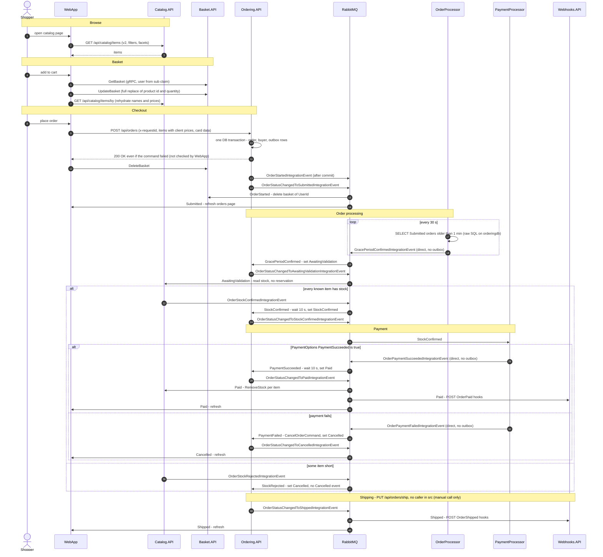
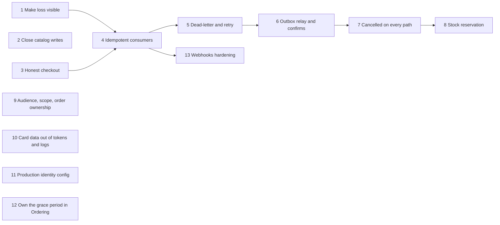

# eShop architecture overview

- Verified at commit: d9aa12b
- Revised at commit dde18d6 against `docs/architecture/verification.md`. ARCH-04 to ARCH-15 were read in the working tree at dde18d6. See the Revision log at the end.
- Inputs: explorer cards in `docs/architecture/services/` (CAT, BAS, ORD, PRC, IDN, WHK, WEB, PLT) and `docs/architecture/themes/` (EVT, SEC).
- Claim IDs in brackets point to those cards. Claims added by this overview use the `[ARCH-NN]` prefix and carry their own evidence (section 0).
- Out of scope, as in the cards: `src/ClientApp` and `src/HybridApp`. Exception: ARCH-08 cites one ClientApp file, because removing token claims affects that client.

## 0. Architect claims and card reconciliation

Code was opened only to settle disagreements between cards, or to answer the verification findings.

- [ARCH-01] The mobile BFF has a catch-all route `/api/catalog/{*any}` that matches only on the `api-version` query value and has no HTTP method restriction. POST, PUT and DELETE therefore reach Catalog.API's anonymous write endpoints through the BFF's external endpoint. Evidence: `src/eShop.AppHost/Extensions.cs:141-143`. This settles CAT-07, which listed only the `/catalog-api/...` read routes (`src/eShop.AppHost/Extensions.cs:97-139`), against PLT-02, which also listed `/api/catalog/*`.
- [ARCH-02] The Paid command handler also waits 10 s (`Task.Delay(10000)`) before it loads the order. Evidence: `src/Ordering.API/Application/Commands/SetPaidOrderStatusCommandHandler.cs:21-22`. This confirms EVT-50. ORD-29 named only the stock-confirmed handler.
- [ARCH-03] An idempotent wrapper, `SetPaidIdentifiedOrderStatusCommandHandler`, already exists (a duplicate returns `true`). The integration-event path sends the plain command instead (EVT-41). Evidence: `src/Ordering.API/Application/Commands/SetPaidOrderStatusCommandHandler.cs:36-50`.
- [ARCH-04] `AddDefaultAuthentication` registers nothing and returns silently when the `Identity` configuration section is missing. When the section exists it requires both `Identity:Url` and `Identity:Audience`. Catalog.API has neither: no appsettings file under `src/` other than Basket, Ordering and Webhooks has an `Identity` section, and the AppHost passes `Identity__Url` to basket-api, ordering-api and webhooks-api but not to catalog-api. Evidence: `src/eShop.ServiceDefaults/AuthenticationExtensions.cs:22-28,35-36`; `src/eShop.AppHost/AppHost.cs:38-40` (catalog-api) versus `:35,46,59`; `src/Basket.API/appsettings.json:17`, `src/Ordering.API/appsettings.json:29`, `src/Webhooks.API/appsettings.json:29` (the only `"Identity"` matches in `src/**/appsettings*.json`).
- [ARCH-05] The `ClientRequest` row and the command already share one database transaction. `TransactionBehavior` opens the transaction for the outer `IdentifiedCommand`, `RequestManager` saves on the same context, and the inner `Send` reuses the open transaction. The request ID stays behind after a failure because `IdentifiedCommandHandler` swallows every exception (`catch { return default; }`), so the outer transaction commits. Validation failures of the inner command are swallowed too, because `ValidatorBehavior` throws inside the inner `Send`. Evidence: `src/Ordering.API/Extensions/Extensions.cs:39-41`, `src/Ordering.API/Application/Behaviors/TransactionBehavior.cs:27-30,38-47`, `src/Ordering.Infrastructure/Idempotency/RequestManager.cs:34-36`, `src/Ordering.API/Application/Commands/IdentifiedCommandHandler.cs:48,87,99-102`, `src/Ordering.API/Application/Behaviors/ValidatorBehavior.cs:32`. This corrects the mechanism the first version of step 3 assumed. ORD-27's effect is unchanged.
- [ARCH-06] `POST /api/orders` returns `200 OK` whether the command succeeded or not. It only logs a warning on `false`. Cancel and ship return a 500 problem on `false`. Evidence: `src/Ordering.API/Apis/OrdersApi.cs:155-166` versus `:41-46` and `:70-75`.
- [ARCH-07] The CVV is logged in clear on the create path. When `x-requestid` is missing, the whole request, including the unmasked card number, is logged at Warning. Otherwise the command, with `CardSecurityNumber` in clear (only the number is masked), is logged with `{@Command}` by the endpoint, by `LoggingBehavior`, by `TransactionBehavior` and by `IdentifiedCommandHandler`. `CreateOrderCommand` has no logging exclusion on those properties. Evidence: `src/Ordering.API/Apis/OrdersApi.cs:134,140-153`, `src/Ordering.API/Application/Behaviors/LoggingBehavior.cs:9`, `src/Ordering.API/Application/Behaviors/TransactionBehavior.cs:41,59`, `src/Ordering.API/Application/Commands/IdentifiedCommandHandler.cs:79-84`, `src/Ordering.API/Application/Commands/CreateOrderCommand.cs:43-53`. This replaces ORD-05, which verification marked WRONG.
- [ARCH-08] In the shipped code the card data in Identity is placeholder data, and only the MAUI client reads it.
  - Identity.API creates users in two places only. The seed sets a masked number and a test CVV. External-login auto-provisioning sets no card fields. No other code in Identity.API writes `CardNumber` or `SecurityNumber`. Evidence: `src/Identity.API/UsersSeed.cs:18,30,33,63,75,78`, `src/Identity.API/Quickstart/Account/ExternalController.cs:200-204`.
  - The only readers of `card_*` claims in `src/` are in the MAUI client. WebApp sends its own hard-coded card. Evidence: `src/ClientApp/Services/Identity/IdentityService.cs:85-88`, `src/WebApp/Services/BasketState.cs:100-103`.
  - This replaces the second sentence of IDN-22 ("Other services read this payment data"), which verification marked WRONG. The producing side of IDN-22 (`ProfileService.cs:70-80`) stands.
- [ARCH-09] A file `tempkey.jwk` sits in the Identity.API source tree, no `.gitignore` excludes it, and the project copies it to the build output. IdentityServer is configured with `AddDeveloperSigningCredential` and key management off. Evidence: `src/Identity.API/tempkey.jwk`, `src/Identity.API/Identity.API.csproj:50`, `src/Identity.API/Program.cs:29,37`. That this file is the key the developer credential loads is Duende framework behaviour and is not shown in this repository (see Revision log).
- [ARCH-10] Webhooks.API's outbound `HttpClient` gets the standard resilience handler (retry, timeout, circuit breaker) through `AddServiceDefaults`. The sender still faults the whole handler through `Task.WhenAll` and never checks status codes. The grant handshake accepts any URL that answers OPTIONS with 2xx when the subscriber supplied no token, because `tokenExpected` is then null and a missing header also yields null. Evidence: `src/eShop.ServiceDefaults/Extensions.cs:22-29`, `src/Webhooks.API/Program.cs:3`, `src/Webhooks.API/Services/WebhooksSender.cs:7,10,32`, `src/Webhooks.API/Services/GrantUrlTesterService.cs:22-27`. This replaces the "no retry, no timeout" parts of WHK-29 and EVT-38, which verification marked partly WRONG. PLT-18 already stated the resilience default.
- [ARCH-11] An outbox row whose event type cannot be resolved does not yield a null event. The lookup returns a null `Type`, and `JsonSerializer.Deserialize(Content, null, ...)` then throws, so one stale row fails the whole pending batch it belongs to. Evidence: `src/IntegrationEventLogEF/Services/IntegrationEventLogService.cs:27-28`, `src/IntegrationEventLogEF/IntegrationEventLogEntry.cs:35-37`. This replaces EVT-59, which verification marked WRONG. Today the batch is filtered to the current TransactionId (PLT-13), so stale rows are hit only once a relay reads older rows (step 6).
- [ARCH-12] The outbox primary key is the event ID. Inserting a row with an ID that is already present fails the save, and Catalog's stock handler saves its outgoing event through that path. Evidence: `src/IntegrationEventLogEF/IntegrationLogExtensions.cs:11`, `src/Catalog.API/IntegrationEvents/EventHandling/OrderStatusChangedToAwaitingValidationIntegrationEventHandler.cs:31`, `src/Catalog.API/IntegrationEvents/CatalogIntegrationEventService.cs:28`.
- [ARCH-13] The payment-failed path ends in Cancelled and publishes the Cancelled integration event. The handler sends `CancelOrderCommand`, whose handler calls `SetCancelledStatus`. That method raises `OrderCancelledDomainEvent` from any state except Paid and Shipped, and its handler saves `OrderStatusChangedToCancelledIntegrationEvent` to the outbox. Evidence: `src/Ordering.API/Application/IntegrationEvents/EventHandling/OrderPaymentFailedIntegrationEventHandler.cs:12,21`, `src/Ordering.API/Application/Commands/CancelOrderCommandHandler.cs:27-28`, `src/Ordering.Domain/AggregatesModel/OrderAggregate/Order.cs:142-153`, `src/Ordering.API/Application/DomainEventHandlers/OrderCancelledDomainEventHandler.cs:30-31`. This answers the open question in the EVT card. Only the stock-rejected path lacks the event (EVT-54).
- [ARCH-14] Nothing in `src/` calls `PUT /api/orders/ship`. A grep of `*.cs` for `/ship` and `ShipOrder` matches only Ordering.API's own endpoint, command, validator and handlers. Evidence: `src/Ordering.API/Apis/OrdersApi.cs:12,51-78`. Shipped, and with it the OrderShipped webhook, happens only through a manual call to that endpoint.
- [ARCH-15] Identity declares its `ApiResource` entries without scopes, while the APIs configure audiences `orders`, `basket` and `webhooks`. The code does not show that the access tokens Identity issues carry these `aud` values. Evidence: `src/Identity.API/Configuration/Config.cs:10-12` (resources) and `:22-24` (scopes), `src/Ordering.API/appsettings.json:30`, `src/Basket.API/appsettings.json:18`, `src/Webhooks.API/appsettings.json:31`.
- Still open: the connection name is `eventbus` in some services and `EventBus` in others (EVT-22, PRC-13). It is not ranked, because all participants run in one AppHost topology with a single `eventbus` resource (PLT-14).

Claims marked WRONG or NOT CONFIRMED by verification, and how this overview now treats them:
- ORD-05 (WRONG): no longer cited. Replaced by ARCH-07.
- EVT-59 (WRONG): no longer cited. Replaced by ARCH-11.
- WHK-29 and EVT-38 (partly WRONG): cited only for the parts that hold (`Task.WhenAll`, no status check). ARCH-10 covers the resilience default.
- SEC-18 (WRONG): no longer cited. PRC-17 and PRC-18 cover the workers.
- IDN-22 (partly WRONG): cited only for the producing side (`ProfileService` emits `card_*` claims). ARCH-08 covers the readers.
- WHK-37, IDN-21 and WEB-28 (NOT CONFIRMED): not used anywhere in this overview.

## 1. Context and containers

Notes on the diagram:
- The topology and data stores come from PLT-05, PLT-06 and PLT-14. The BFF routes come from PLT-02 and ARCH-01.
- Client calls: WebApp (WEB-12, WEB-13, WEB-14, WEB-16, WEB-17) and WebhookClient (WHK-23, WHK-24).
- Event wiring: EVT-09 to EVT-19.
- Shared-database read by OrderProcessor: EVT-08.
- Catalog is red because it has no authentication (SEC-04).
- Every user call between services carries the user's forwarded access token. No service-level credentials are used (SEC-16). The workers run without any identity. OrderProcessor uses `AddBasicServiceDefaults`, PaymentProcessor uses `AddServiceDefaults`, and neither adds authentication (PRC-17, PRC-18).
- Identity publishes and handles no events (EVT-21).

## 2. Main business flow: browse, basket, checkout, order processing, payment

Evidence for the flow:
- Browse and basket: WEB-19, WEB-06, BAS-05, WEB-24.
- Checkout: WEB-23, ORD-04, ORD-16, EVT-24, EVT-25, EVT-26, WEB-22, EVT-09, EVT-10. The 200 on failure is ARCH-06.
- Grace period: PRC-15, PRC-19, EVT-11, EVT-12.
- Stock: EVT-13, CAT-29.
- Payment: EVT-14, EVT-15, PRC-24, ORD-29, ARCH-02. Payment-failed path: ARCH-13, EVT-18.
- Paid fan-out: EVT-16.
- Stock-rejected path: EVT-54.
- Shipping: EVT-17, ARCH-14.
- Nothing orchestrates the saga. Each step is a reaction to the previous event (EVT-20).

## 3. Top 5 weak spots

| # | Weak spot | Severity | Key claims |
|---|---|---|---|
| 1 | Integration events can be lost silently at every hop | High | EVT-28, EVT-29, EVT-30, EVT-32, EVT-35, EVT-48 |
| 2 | Stock is not reserved, and decrements are neither safe nor idempotent | High | EVT-52, EVT-37, EVT-42, EVT-53, EVT-54 |
| 3 | Catalog writes are public, and API authorization is too coarse | High | SEC-04, ARCH-01, SEC-31, SEC-22, ORD-28 |
| 4 | Identity runs on development credentials, and card data flows into tokens and logs | High | SEC-25, IDN-25, ARCH-09, ARCH-07, IDN-23, ARCH-08 |
| 5 | Checkout can fail silently, and the basket is lost on every cancellation | Medium | WEB-22, ARCH-06, ARCH-05, BAS-23, EVT-51 |

### 3.1 Integration events can be lost silently at every hop (High)

What it is:
- Publish side: Ordering and Catalog write outbox rows atomically with the business change (EVT-24, EVT-27). Nothing relays them, though. A failed publish only marks the row PublishedFailed. The pending query is keyed by the current TransactionId and has a single caller, so a crash between commit and publish leaves a NotPublished row that is never sent (EVT-28, PLT-13, ORD-26, CAT-28).
- A row is marked Published as soon as `PublishAsync` returns. There are no publisher confirms, so an unroutable message goes undetected (EVT-29).
- OrderProcessor and PaymentProcessor publish directly, with no outbox (EVT-30, PRC-11).
- Consume side: when a handler throws, the error is logged and the message is acked anyway. There is no dead-letter exchange and no consumer retry (EVT-32, PLT-21). Later handlers for the same event are skipped (EVT-33). Unknown event types are dropped and acked (EVT-34).
- If the broker connection is not open at startup, the consumer returns silently and the host keeps running without consuming (EVT-35, PLT-23).
- A message body that contains `throw-fake-exception` deliberately throws in the production consumer path (EVT-36, PLT-22).

Why it matters:
- The saga is pure choreography with no orchestrator and no timeouts (EVT-20). A lost event leaves an order stuck in its current status, and no log entry at the domain level shows it (EVT-48).
- Only the Submitted step is re-driven, by OrderProcessor polling (EVT-40). No other step has a re-drive.
- Concrete example: if Catalog's Paid handler throws, the decrement for the whole order is lost and never retried (EVT-37).
- No envelope field supports tracing or reconciliation after the fact. Events carry no correlation ID or sequence number (EVT-03).

### 3.2 Stock is not reserved, and decrements are neither safe nor idempotent (High)

What it is:
- Catalog confirms stock by reading `AvailableStock` without reserving it. The decrement happens only after payment (EVT-52, CAT-29).
- Two concurrent orders for the last units can both be confirmed and paid. `RemoveStock` then quietly removes less than was ordered (EVT-52).
- `RemoveStock` throws when stock is 0. That aborts the decrement for the whole order, and because failures are acked the decrement is lost (EVT-37, CAT-30, EVT-32).
- A redelivered Paid event decrements again, because Catalog keeps no record of which orders it has processed (EVT-42, EVT-39).
- On redelivery, the stock-validation handler emits a new event with a new ID, so downstream services cannot deduplicate it (EVT-31).
- Products unknown to Catalog are skipped, so an order containing them can be confirmed (EVT-53, CAT-31).
- A cancellation caused by rejected stock raises no domain event, so no Cancelled integration event is published on that path (EVT-54, ORD-30).

Why it matters:
- Orders can be confirmed and paid for goods that do not exist (EVT-52, EVT-53).
- Stock drifts in both directions: too high when a decrement is lost (EVT-37), too low when one is duplicated (EVT-42).
- Without a Cancelled event on every cancellation path, no future reservation can be released reliably (EVT-54).

### 3.3 Catalog writes are public, and API authorization is too coarse (High)

What it is:
- Catalog.API has no authentication or authorization code at all (SEC-04, CAT-06), and that includes POST, PUT and DELETE on items (CAT-05, CAT-27, SEC-32).
- Those write methods are reachable from outside through the mobile BFF's catch-all route (ARCH-01, PLT-02). The BFF does no authentication of its own (SEC-09).
- Shared JWT validation sets `ValidateAudience=false` and applies no scope policy. `AddAuthorization()` is called without options, so any valid token issued by Identity, for any client, is accepted by every API (SEC-20, SEC-22, SEC-31, PLT-27).
- `GET /api/orders/{orderId}` loads an order by ID without checking that it belongs to the caller (ORD-28, SEC-13).
- `RequireHttpsMetadata=false` is set on the JWT bearer handler and on the OIDC clients (SEC-33).

Why it matters:
- Anyone who can reach the BFF can change prices and delete items (ARCH-01, CAT-05).
- A price change flows into new orders, because the order stores the price the WebApp read from Catalog (EVT-55, WEB-06). It also emits ProductPriceChanged (CAT-15).
- Any signed-in user can read other users' orders by enumerating integer IDs (ORD-28). Orders contain the delivery address (ORD-11).
- A token issued to a low-trust client, such as an Implicit-flow Swagger UI (IDN-09, IDN-28), works against every API (SEC-31).

### 3.4 Identity runs on development credentials, and card data flows into tokens and logs (High)

What it is:
- Development credentials:
  - The OIDC client secret `"secret"` is hard-coded on both sides (SEC-25, IDN-24, WEB-20, WHK-35).
  - Tokens are signed with the developer signing credential, and automatic key management is off (IDN-25, SEC-28). A `tempkey.jwk` file is part of the source tree and is copied to the build output (ARCH-09).
  - The seeded users `alice` and `bob` share one password and are seeded on every startup (IDN-26).
  - `webapp` runs without PKCE, and the Swagger UI clients use the Implicit flow (IDN-28).
  - The AppHost defines no secret parameters and no secret store (SEC-27).
- Card data by design:
  - Card number, CVV and expiry are plain properties on `ApplicationUser` (IDN-12, IDN-23).
  - `ProfileService` copies them into token claims. For `maui`, `webapp` and `webhooksclient` they also go into the ID token (IDN-22 producing side, IDN-23, SEC-37). The only reader of these claims is the MAUI client (ARCH-08).
  - Card number and CVV travel through `CreateOrderCommand` and the `Order` constructor into `OrderStartedDomainEvent`. The `Order` itself does not store them. Only the number is masked, in the API layer (ORD-33).
  - Ordering logs the CVV in clear in several places on the create path, and logs the unmasked card number when `x-requestid` is missing (ARCH-07).
- What the shipped code actually holds: the seeded card numbers are masked placeholders with test CVVs, Identity.API has no user registration that captures card data, and WebApp sends a hard-coded test card (ARCH-08, WEB-21).

Why it matters:
- The High rating rests on the credentials. If a deployment keeps these defaults, anyone holding the shared secret can authenticate as a confidential client (SEC-25). If the developer credential loads the `tempkey.jwk` from the repository, anyone with repository access holds the token signing key (IDN-25, ARCH-09). Because no API validates audience or scope, a forged or misused token works against every API (SEC-31).
- The card-data part is a design risk, Medium on its own. Today it exposes only placeholder data (ARCH-08). But the paths are live: any real card a client sends to Ordering lands in the logs with its CVV (ARCH-07), and any real card stored on a user lands in every token and in browser-held ID tokens (SEC-37, IDN-23).

### 3.5 Checkout can fail silently, and the basket is lost on every cancellation (Medium)

What it is:
- Ordering's `POST /api/orders` returns 200 even when the command fails (ARCH-06). WebApp does not check the result either, and deletes the basket immediately afterwards (WEB-22, EVT-51).
- `IdentifiedCommandHandler` saves the request ID, runs the command, and turns every exception, including validation failures, into `false`. Because the exception is swallowed, the transaction commits with the request ID in it. A retry with the same `x-requestid` is then treated as a duplicate and returns `true` (ORD-27, EVT-46, ARCH-05).
- Basket also deletes the basket on `OrderStarted`, before the order is final. A later cancellation (grace period, stock rejection, payment failure) does not restore it (BAS-23, EVT-51). This needs no failure on the create path: every cancelled order loses its basket.
- A duplicate `OrderStarted` deletes any basket the user has built since then (EVT-45).
- Basket writes are blind overwrites, and WebApp does read-modify-write from the client (BAS-22, WEB-24, EVT-57).

Why it matters:
- A customer can end up with no basket and no order, and the UI never reports the failure (ARCH-06, WEB-22, EVT-51).
- A retry reports success for an order that was never created (EVT-46, ARCH-05).
- Every customer whose order is cancelled by stock rejection or payment failure has to rebuild the basket (BAS-23, EVT-51).
- Severity is medium rather than high: the harm is lost baskets and hidden failures, not lost money, stock or data integrity in the order records. The loss on cancellation happens in normal operation, without any create-path failure (BAS-23, EVT-51), which is why this ranks above the runners-up.

### Considered but not ranked

- Webhooks:
  - The service makes outbound calls to user-supplied URLs with no allow or deny list (WHK-27, SEC-36). The grant handshake limits this less than it appears: the grant URL must share scheme, host and port with the hook URL (WHK-26), but when the subscriber supplies no token, any URL that answers OPTIONS with 2xx passes (ARCH-10).
  - Delivery is not durable (WHK-30). The default HttpClient pipeline already adds retry, timeout and a circuit breaker (ARCH-10, PLT-18). What remains: `Task.WhenAll` faults the handler when any receiver throws, and status codes are not checked (WHK-29 and EVT-38, those parts only; ARCH-10). Because the default retry can replay a POST, duplicate hooks are a bigger risk than missing retries (EVT-44, ARCH-10).
  - The subscriber token is logged (WHK-28, SEC-34).
  - Severity: medium.
- Shared-database coupling: OrderProcessor queries Ordering's table and column names directly in SQL. It swallows database errors, so a schema change silently stops the grace period (EVT-08, PRC-23, EVT-60, PRC-21). Severity: medium.
- Event contracts are copied into each service and matched by short class name, with no version field (EVT-23, EVT-03, PLT-26). A stored outbox row whose type no longer resolves makes deserialisation throw and fails its whole batch (ARCH-11). Severity: low to medium.
- Migrations run at startup in every service that has a database (PLT-08, CAT-33, IDN-27). Health endpoints are mapped only in Development, yet the AppHost health checks depend on them (PLT-31). Severity: low.

## 4. Target architecture: strangler-fig steps

Principles:
- Keep the current services, databases and event names.
- Each step ships on its own, behind a configuration flag where behaviour changes, and the system keeps running throughout.
- Dependencies, matching the diagram below:
  - Step 1 comes first, so the later steps can be measured.
  - Steps 3 to 8 run in order. Step 3 is in the chain because it stops `IdentifiedCommandHandler` from swallowing exceptions (ARCH-05). Until then, step 4's wrapper routing and step 5's dead-letter queue cannot see Ordering failures. Steps 4 to 8 are ordered because more redelivery is only safe once consumers are idempotent (EVT-39).
  - Step 13 needs step 4's dedup.
  - Steps 2, 9, 10, 11 and 12 are independent and can run in parallel with the chain.
  - Step 12 detects orders stuck after Submitted but does not repair them. In particular it does not close the PaymentProcessor publish gap (step 6 risk).

### Step 1. Make event loss visible
- Goal: measure lost and stuck events before changing anything (weak spot 3.1).
- Change:
  - Add a metric for IntegrationEventLog rows in each State, older than N minutes, in Ordering and Catalog (EVT-04, PLT-07).
  - Add counters for consumer exceptions that were acked (EVT-32) and for unknown events that were dropped (EVT-34).
  - Add a readiness check that fails while the RabbitMQ consumer is not running (EVT-35, PLT-23).
  - Map health endpoints outside Development, on an internal port only (PLT-31).
- Risk: low, because the change is read-only. Hosts that were running silently without a consumer (EVT-35) will now show as unhealthy and restart.
- Verify:
  - Start a service with RabbitMQ down and confirm readiness goes red.
  - In a test, make a handler throw and confirm the acked-failure counter goes up.

### Step 2. Close Catalog writes
- Goal: only authorized callers can change catalog items and prices (weak spot 3.3).
- Change:
  - (a) Restrict the BFF catch-all `/api/catalog/{*any}` to GET (ARCH-01).
  - (b) Wire authentication into Catalog.API. Calling `AddDefaultAuthentication()` alone does nothing, because Catalog has no `Identity` section and the helper then returns silently (ARCH-04). The step therefore:
    - adds an `Identity` section with an `Audience` to Catalog's appsettings, and `.WithEnvironment("Identity__Url", identityEndpoint)` to catalog-api in the AppHost, as the other APIs have (ARCH-04, SEC-15);
    - calls `AddDefaultAuthentication()` and fails closed: Catalog refuses to start, or rejects writes, when the `Identity` section is missing, instead of silently running without authentication (ARCH-04);
    - puts an authorization policy on the POST, PUT and DELETE item endpoints (CAT-05, CAT-27). Reads stay anonymous.
  - The cards show no admin role or catalog scope in Identity (IDN-08 lists only `orders`, `basket`, `webhooks`), so the policy's claim is a new decision. This step does not assume one exists.
- Risk: unknown callers that write to Catalog will break. WebApp uses read endpoints only (WEB-19). Log write calls for one release before enforcing (b). A missing `Identity` section in any environment now stops Catalog instead of opening it, which is the intended trade-off.
- Verify:
  - An anonymous PUT through the BFF gets no route match.
  - An anonymous PUT on the internal endpoint returns 401.
  - Starting Catalog without the `Identity` section fails, or write calls are rejected.
  - WebApp browse and search still work.

### Step 3. Honest checkout
- Goal: a failed order never looks successful, a failed request can be retried, and the basket survives until an order exists (weak spot 3.5).
- Change:
  - Stop swallowing exceptions in `IdentifiedCommandHandler` (remove the `catch { return default; }`). The `ClientRequest` row is already written in the same transaction as the command, so a propagating exception rolls both back and leaves no request ID behind (ARCH-05, ORD-27, EVT-46). No change to where the row is written is needed.
  - Map `OrderingDomainException` (thrown by validation and by invalid transitions) to 400, so callers see a client error rather than an unhandled 500 (ARCH-05, ORD-31).
  - Make `POST /api/orders` return an error when the command result is `false`, as cancel and ship already do (ARCH-06).
  - WebApp checks the `CreateOrder` status and clears the basket only on success (WEB-22).
  - Keep a single owner of basket deletion: either WebApp or the OrderStarted handler (EVT-51, BAS-23). Restoring the basket on cancellation is out of scope for this step; with WebApp as the owner, only a successful create clears it.
- Risk:
  - Clients that relied on create always returning 200, including MAUI through the BFF (PLT-02), now see errors for failed orders (ARCH-06).
  - Cancel and ship now surface exceptions directly instead of `false` (ARCH-06). Their status code stays 500, or becomes 400 for domain exceptions.
  - Event handlers that send identified commands will see exceptions instead of `false` once step 4 routes them through the wrapper. That is the intended input for step 5.
- Verify:
  - Send a create request whose command fails validation. Today it returns 200 (ARCH-06). After the change it returns 400, the basket remains and the UI shows an error.
  - Retry the same request with the same `x-requestid` after fixing the input, and confirm exactly one order is created (ARCH-05).

### Step 4. Idempotent consumers (inbox)
- Goal: duplicate events are harmless. This is the prerequisite for steps 5 and 6.
- Change:
  - Add an inbox table keyed by (event Id, handler) in catalogdb and write it in the same transaction as the stock change. Start with the Paid handler (EVT-42, EVT-39). Reuse the existing `ResilientTransaction` (PLT-12).
  - In Catalog's stock-validation handler, derive the outgoing event ID deterministically from the incoming one, so a redelivery produces the same ID (EVT-31). The outbox key is the event ID, so the second insert fails (ARCH-12). The handler must treat that conflict as "already done": skip the save and, if the existing row is not Published, republish it. Without that conflict handling the redelivery throws instead of being idempotent.
  - In Webhooks, record (event Id, subscription) before sending (EVT-44).
  - In Ordering, route event-driven status commands through the existing `IdentifiedCommand` wrapper, keyed by event ID (ARCH-03, EVT-41). This needs step 3: while the wrapper swallows exceptions, a failed status change commits its request ID and later redeliveries are discarded as duplicates (ARCH-05).
- Risk: the inbox tables grow and need a retention job. A handler that does not include the inbox write in its transaction remains unsafe.
- Verify:
  - Publish the same Paid event twice and confirm stock is decremented once.
  - Deliver the same AwaitingValidation event twice and confirm one outbox row and one downstream event ID.
  - Confirm a webhook receiver gets one POST per event.

### Step 5. Dead-letter and bounded retry on the consumer side
- Goal: a failing handler no longer loses its event (weak spot 3.1).
- Change:
  - Replace ack-on-exception with nack to a per-queue dead-letter exchange, with a bounded delayed retry (EVT-32, PLT-21). Apply this through a broker policy, so the existing durable queues need no redeclaration (EVT-02).
  - Run each handler of an event independently (EVT-33).
  - Remove the `throw-fake-exception` branch, or gate it to Development (EVT-36, PLT-22).
- Risk:
  - Retries replay any handler that is not idempotent (EVT-42, EVT-44), so this step requires step 4.
  - In Ordering, a failure inside an identified command reaches the consumer only after step 3 removes the exception swallow (ARCH-05).
- Verify:
  - A handler that always throws ends up in the DLQ after N attempts.
  - The acked-failure counter from step 1 drops to zero.

### Step 6. Outbox relay and publisher confirms
- Goal: no committed event stays unsent (weak spot 3.1).
- Change:
  - Add a hosted relay in Ordering.API and Catalog.API that republishes NotPublished and PublishedFailed rows, and InProgress rows older than a timeout, regardless of TransactionId, using the same event ID (EVT-28, PLT-12, PLT-13, EVT-05).
  - Resolve the event type per row before deserialising. A row whose type does not resolve must be logged and parked (for example, a new state), because passing it on makes deserialisation throw and fails every row in the same batch (ARCH-11).
  - Keep the in-request publish as the fast path (EVT-26).
  - Enable publisher confirms and mark a row Published only after the broker acks it (EVT-29).
- Risk:
  - The relay increases duplicates (EVT-39), which is why step 4 must come first.
  - Old rows whose event type was renamed would stop the relay batch if parking is done after deserialisation rather than before it (ARCH-11).
  - The processors still publish directly (EVT-30). Neither this step nor step 12 closes that gap: step 12 re-drives only the Submitted step and only flags orders stuck later. A lost payment event leaves the order in StockConfirmed until someone acts. Options, not yet chosen:
    - give PaymentProcessor an outbox (it has no storage today, PRC-06, so this adds a store), or
    - have Ordering republish StockConfirmed for orders stuck past a timeout. This is safe only while payment is simulated (PRC-24) and Ordering's status guard drops the extra result (EVT-47). A real payment provider would need an idempotency key per order first.
- Verify:
  - Block the broker after commit, restore it, and confirm the row reaches Published and the order advances.
  - Insert a row with an unknown type name and confirm it is parked while the other pending rows publish.
  - The stuck-row metric from step 1 returns to near zero.

### Step 7. Publish Cancelled on the stock-rejected path
- Goal: every cancellation is visible to other services. This is the prerequisite for releasing reservations in step 8.
- Change:
  - Raise the cancelled domain event in `SetCancelledStatusWhenStockIsRejected`, as `SetCancelledStatus` already does (EVT-54, ORD-30).
  - The payment-failed path already ends in Cancelled and publishes the event (ARCH-13). No change there.
- Risk: WebApp already handles Cancelled (EVT-18). New subscribers get the event only once they opt in, so the blast radius is small.
- Verify: a stock-rejected order produces exactly one `OrderStatusChangedToCancelledIntegrationEvent`.

### Step 8. Stock reservation in Catalog
- Goal: no oversell and no lost decrements (weak spot 3.2).
- Change:
  - On AwaitingValidation, reserve all lines in one transaction with a conditional update on available stock. Reject the order if any line is unknown or short (EVT-52, EVT-53, CAT-29, CAT-31).
  - On Paid, turn the reservation into a sale. This removes the throwing `RemoveStock` path (EVT-37, CAT-30).
  - On Cancelled, release the reservation. This requires step 7.
  - Run the new handlers behind a flag next to the old ones.
- Risk: reservations leak if a Cancelled event is lost, so steps 5 and 6 come first. Add a reconciliation job that releases reservations for orders that are no longer active.
- Verify:
  - Two concurrent orders for the last unit produce one confirmation and one rejection.
  - A cancellation releases the reservation.
  - An unknown product is rejected.

### Step 9. Audience, scope and order ownership
- Goal: a token meant for one API cannot be used against another, and users see only their own orders (weak spot 3.3).
- Change:
  - Filter `GET /api/orders/{orderId}` by the caller's buyer ID (ORD-28, SEC-13).
  - Audience validation, in three parts:
    - First, in log-only mode, record the `aud` claim of incoming tokens at Ordering, Basket and Webhooks. The APIs expect `orders`, `basket` and `webhooks`, but Identity's `ApiResource` entries have no scopes, and the code does not show that issued tokens carry these audiences (ARCH-15, IDN-08).
    - If the audiences are missing, attach each scope to its `ApiResource` in Identity's `Config.cs` (ARCH-15).
    - Only then set `ValidateAudience=true` (SEC-20, SEC-15).
  - Add scope policies for `orders`, `basket` and `webhooks` (IDN-08, SEC-22).
  - Set `RequireHttpsMetadata=true` outside Development (SEC-33).
  - Run one release in log-only mode before enforcing.
- Risk:
  - Turning on audience validation before the tokens carry the audience would reject every call (ARCH-15). The log-only phase is a hard gate, not an option.
  - Some clients request scopes that are not registered (`mobileshoppingagg`, `webshoppingagg`, IDN-29).
- Verify:
  - The log-only phase shows the expected `aud` on tokens from WebApp, WebhookClient and the BFF before enforcement starts.
  - A token with only the webhooks scope gets 401 or 403 from Ordering.
  - A GET for another user's order returns 404.

### Step 10. Card data out of logs, tokens and order events
- Goal: no card data in logs, tokens or domain events (weak spot 3.4).
- Change, in order of independence:
  - Stop logging card data in Ordering. Do not log the raw request when `x-requestid` is missing. Keep `CardNumber` and `CardSecurityNumber` out of every `{@Command}` log of `CreateOrderCommand`: in the endpoint, `LoggingBehavior`, `TransactionBehavior` and `IdentifiedCommandHandler` (ARCH-07). This needs no client change.
  - Stop passing the CVV into `OrderStartedDomainEvent` (ORD-33).
  - Give the simulated payment (PRC-24) a payment reference instead of card data.
  - Set `AlwaysIncludeUserClaimsInIdToken` to false for `webapp` and `webhooksclient`. Neither reads `card_*` claims (ARCH-08, IDN-23).
  - Stop emitting `card_*` claims from `ProfileService` (IDN-22 producing side, IDN-23) only after the MAUI client stops reading them, because it is the one reader (ARCH-08).
  - Later, move the card columns off `ApplicationUser` (IDN-12).
- Risk: removing the claims before the MAUI client changes breaks its checkout prefill (ARCH-08). The logging change is low risk.
- Verify:
  - Ordering logs from a checkout, and from a request without `x-requestid`, contain no CVV and no unmasked card number.
  - Decoded ID tokens for `webapp` contain no `card_*` claims.
  - WebApp checkout still works end to end.

### Step 11. Production identity configuration
- Goal: no development credentials in a deployed environment (weak spot 3.4).
- Change:
  - Supply client secrets through AppHost parameters or a secret store instead of `"secret"` literals (SEC-25, SEC-27).
  - Replace the developer signing credential with managed keys (IDN-25). Remove `tempkey.jwk` from the repository and from the build output (ARCH-09).
  - Set `RequirePkce=true` for `webapp` and retire the Implicit Swagger clients (IDN-28).
  - Seed users in Development only (IDN-26).
- Risk: changing the signing key invalidates live tokens and sessions, which last up to 2 hours (SEC-23). Schedule the change in a low-traffic window.
- Verify:
  - `tempkey.jwk` is absent from the build output.
  - The discovery document shows the managed key.
  - Login works with PKCE.

### Step 12. Own the grace period in Ordering
- Goal: Ordering can change its schema without breaking order processing, and stuck orders become visible (weak spot 3.1 and the shared-database runner-up).
- Change:
  - Move the grace-period timer into Ordering as a hosted service over its own DbContext, behind a flag. Then retire OrderProcessor's raw SQL (EVT-08, PRC-23, EVT-60).
  - Record which orders have been sent, so the timer stops republishing every 30 s (PRC-20, EVT-40).
  - Fail loudly on database errors instead of returning an empty list (PRC-21).
  - Extend the timer to flag orders stuck in AwaitingValidation or StockConfirmed (EVT-48). Flagging is detection only. It does not re-publish anything, so it does not replace an outbox for PaymentProcessor (step 6 risk).
- Risk: during the overlap both timers fire. That is harmless, because Ordering acts only on Submitted orders (EVT-40).
- Verify:
  - The grace period still advances orders with OrderProcessor stopped.
  - A renamed column fails a migration test instead of failing silently.

### Step 13. Webhooks hardening
- Goal: safe and reliable hook delivery, with no duplicates (runner-up).
- Change:
  - Reject loopback, private and link-local destinations at registration and at send time (WHK-27, SEC-36).
  - Require a non-empty token at registration, so the grant handshake actually proves control of the URL. Today an empty token lets any 2xx OPTIONS response pass (ARCH-10, WHK-26).
  - Deduplicate by (event Id, subscription) from step 4 (EVT-44). Retry and timeout already come from the default resilience handler (ARCH-10, PLT-18). Because that handler can replay a POST, dedup matters more than adding retries.
  - Write a delivery log row per (event Id, subscription) before sending, and record the status code and attempt count, so delivery survives a restart (WHK-30).
  - Send to each receiver independently and check status codes, so one failing receiver no longer faults the handler (ARCH-10, WHK-29 and EVT-38 for those parts).
  - Decide whether retries are owned by the resilience handler or by the delivery log. If by the log, turn off the handler's retry for this client so the two do not stack (ARCH-10).
  - Stop logging tokens (WHK-28, SEC-34).
  - Sign payloads with HMAC (WHK-31).
  - Either implement the price-change type or stop accepting it (WHK-32).
- Risk: existing subscribers on internal addresses, or registered without a token, stop receiving hooks. List them before enforcing.
- Verify:
  - Registering `http://169.254.169.254/...` is rejected.
  - Registering without a token is rejected.
  - One receiver that returns 500 shows a failed row in the delivery log and does not block the others.
  - A redelivered Paid event does not send a second hook (step 4).

## Revision log

Revision of 2026-11-12 at commit dde18d6, against `docs/architecture/verification.md`. Finding numbers refer to the "Overview conclusions not supported by the evidence" section of that file. "Claim" rows refer to its "Claims that are not CONFIRMED" table.

| # | Finding | What changed | Sections touched | Evidence |
|---|---|---|---|---|
| 1 | Finding 1: step 2(b) `AddDefaultAuthentication()` would do nothing | Step 2(b) now adds the `Identity` section, the AppHost `Identity__Url` wiring and a fail-closed check, plus a verify item for the missing section. Added ARCH-04. | 0, 4 (step 2) | `AuthenticationExtensions.cs:22-28,35-36`; `AppHost.cs:38-40` vs `:35,46,59`; appsettings grep |
| 2 | Finding 1, residual | Evidence gap: no admin role, admin claim or catalog scope exists in the cards or in `Config.cs`. The step says the policy's claim is an open decision instead of naming one. | 4 (step 2) | `src/Identity.API/Configuration/Config.cs:10-12,22-24` (IDN-08) |
| 3 | Finding 2: step 3 misdiagnoses idempotency | Step 3 now removes the exception swallow, maps domain exceptions to 400 and makes create return an error on `false`. It no longer asks to move the `ClientRequest` write. Added ARCH-05 and ARCH-06. | 0, 4 (step 3) | `IdentifiedCommandHandler.cs:48,87,99-102`; `TransactionBehavior.cs:27-30,38-47`; `RequestManager.cs:34-36`; `OrdersApi.cs:155-166` |
| 4 | Finding 2: verify step could not happen | Replaced "force Ordering to return 500" with a create request that fails validation, which today returns 200. | 4 (step 3) | `ValidatorBehavior.cs:32`; `OrdersApi.cs:166` |
| 5 | Finding 2: the swallow also defeats steps 4 and 5 | Step 4 now explains that wrapper routing needs step 3 because of the swallow. Step 5 has a new risk bullet for Ordering. | 4 (steps 4, 5) | ARCH-05 |
| 6 | Finding 3: "full card data, CVV included" overstated | Weak spot 3.4 is renamed and split. The High rating now rests on the development credentials. The card-data part is rated Medium on its own, and the section states that the shipped data are placeholders. Added ARCH-08 and ARCH-09. | 3 (table, 3.4), 0 | `UsersSeed.cs:18,30,63,75`; `ExternalController.cs:200-204`; `BasketState.cs:100-103`; `Identity.API.csproj:50`; `src/Identity.API/tempkey.jwk` |
| 7 | Finding 3: step 10 "readers of `card_*` not known" | Step 10 names the MAUI client as the one reader. It turns off ID-token claims for `webapp` and `webhooksclient` first, and removes the claims only after MAUI changes. | 4 (step 10) | `src/ClientApp/Services/Identity/IdentityService.cs:85-88` |
| 8 | Finding 3: "no card data in logs" not backed; CVV logging omitted | Added ARCH-07 (replaces ORD-05). Weak spot 3.4 lists the logging. Step 10 starts with log redaction and adds a log-based verify item. | 0, 3 (3.4), 4 (step 10) | `OrdersApi.cs:134,140-153`; `LoggingBehavior.cs:9`; `TransactionBehavior.cs:41,59`; `IdentifiedCommandHandler.cs:79-84`; `CreateOrderCommand.cs:43-53` |
| 9 | Finding 4: step 13 and the webhooks runner-up say no retry or timeout | The runner-up and step 13 now state that the default resilience handler exists. Step 13 is reframed around dedup, a delivery log, per-receiver isolation and status checks. Added ARCH-10. | 0, 3 (runner-up), 4 (step 13) | `ServiceDefaults/Extensions.cs:22-29`; `Webhooks.API/Program.cs:3`; `WebhooksSender.cs:7,10,32` |
| 10 | Finding 4, residual | Evidence gap: whether the standard resilience handler retries POST is framework behaviour, and the repository does not override it. The text says "can replay a POST", and step 13 asks for an explicit decision, without asserting it either way. | 3 (runner-up), 4 (step 13) | `src/eShop.ServiceDefaults/Extensions.cs:22-29` (no options passed) |
| 11 | Finding 4: grant handshake limits SSRF less than stated | The runner-up now says an empty token passes any 2xx OPTIONS response. Step 13 requires a non-empty token. | 3 (runner-up), 4 (step 13) | `GrantUrlTesterService.cs:22-27` |
| 12 | Finding 5: step 6 "renamed types resolve to null" | Step 6 now resolves the type per row and parks unresolvable rows before deserialising. It adds a verify item. Added ARCH-11 (replaces EVT-59). | 0, 4 (step 6) | `IntegrationEventLogService.cs:27-28`; `IntegrationEventLogEntry.cs:35-37` |
| 13 | Finding 6: "step 12 covers the PaymentProcessor gap" | Removed. Step 6 now says the gap stays open and lists two options with their preconditions. Step 12 says flagging is detection only. | 4 (steps 6, 12) | EVT-30, EVT-40, EVT-48, PRC-06, PRC-24 |
| 14 | Finding 7: principles inconsistent | The principles now list the dependencies as the diagram draws them: 1 first, 3 to 8 in a chain, 13 after 4, and 2, 9, 10, 11, 12 independent. The text also says why step 3 is in the chain and that step 12 does not repair stuck orders. The diagram is unchanged except the step 10 label. | 4 (principles) | ARCH-05, EVT-39 |
| 15 | Finding 8: payment-failed path treated as open | The sequence diagram now shows CancelOrderCommand, Cancelled and the Cancelled event. Step 7 is retitled, and its "confirm" bullet is replaced by a statement backed by ARCH-13. | 0, 2, 4 (step 7) | `OrderPaymentFailedIntegrationEventHandler.cs:12,21`; `CancelOrderCommandHandler.cs:27-28`; `Order.cs:142-153`; `OrderCancelledDomainEventHandler.cs:30-31` |
| 16 | Finding 8: `PUT /ship` caller treated as open | The diagram note and the evidence list now say there is no caller in `src/`. Added ARCH-14. | 0, 2 | `OrdersApi.cs:12,51-78`; grep of `src/**/*.cs` for `/ship`, `ShipOrder` |
| 17 | Finding 9: weak spot 5 severity rationale | The rationale is rewritten: the basket is lost on every cancellation without any create-path failure. Severity stays Medium, on harm (baskets and hidden failures, not money or order integrity). The title and table row are updated. | 3 (table, 3.5) | BAS-23, EVT-51, ARCH-06 |
| 18 | Finding 10: step 4 event-ID derivation not idempotent | Step 4 now requires conflict handling on the outbox key: skip the save and republish if not Published. It adds a verify item. Added ARCH-12. | 0, 4 (step 4) | `IntegrationLogExtensions.cs:11`; `OrderStatusChangedToAwaitingValidationIntegrationEventHandler.cs:31` |
| 19 | Finding 11: step 9 assumes tokens already carry the audiences | Step 9 now splits audience validation into log `aud`, then fix `ApiResource` scopes if needed, then enforce. The log-only phase is a hard gate. Added ARCH-15. | 0, 4 (step 9) | `Config.cs:10-12,22-24`; `Ordering.API/appsettings.json:30`; `Basket.API/appsettings.json:18`; `Webhooks.API/appsettings.json:31` |
| 20 | Finding 11, residual | Evidence gap: whether Duende emits `aud` for an `ApiResource` without scopes is framework behaviour. The overview does not claim either outcome; the log-only phase decides. | 4 (step 9) | `src/Identity.API/Configuration/Config.cs:10-12` |
| 21 | Claim ORD-05 (WRONG) | No longer cited. Replaced by ARCH-07 in weak spot 3.4 and step 10. | 0, 3 (3.4), 4 (step 10) | See row 8 |
| 22 | Claim EVT-59 (WRONG) | No longer cited. The event-contracts runner-up and step 6 now use ARCH-11. | 0, 3 (runner-up), 4 (step 6) | See row 12 |
| 23 | Claims WHK-29, EVT-38 (partly WRONG) | Cited only for `Task.WhenAll` and the missing status check. The retry and timeout statements now rest on ARCH-10. | 3 (runner-up), 4 (step 13) | See row 9 |
| 24 | Claim SEC-18 (WRONG) | Section 1 note now cites PRC-17 and PRC-18, and says which defaults each worker uses. | 1 | `src/OrderProcessor/Program.cs:3`, `src/PaymentProcessor/Program.cs:3` |
| 25 | Claim IDN-22 (partly WRONG) | Cited only for the producing side. Readers now come from ARCH-08. | 3 (3.4), 4 (step 10) | `ProfileService.cs:70-80`; `ClientApp/.../IdentityService.cs:85-88` |
| 26 | Claims WHK-37, IDN-21, WEB-28 (NOT CONFIRMED) | No change: the overview does not cite them. | none | grep of `overview.md` before revision |
| 27 | ORD-33 note: `Order` does not store card data | Weak spot 3.4 now says the card data passes through the `Order` constructor into the domain event, and the `Order` does not store it. Step 10 now targets the domain event only. | 3 (3.4), 4 (step 10) | `Order.cs:52-65` |
| 28 | Consequence of row 6 | Step 11 now also removes `tempkey.jwk` from the repository and the build output. | 4 (step 11) | ARCH-09 |
| 29 | ARCH-09, residual | Evidence gap: that `AddDeveloperSigningCredential` loads this `tempkey.jwk` is Duende behaviour, not shown in the repository. Weak spot 3.4 states the forgery risk conditionally ("if the developer credential loads the file"). | 0, 3 (3.4) | `Identity.API.csproj:50`; `Program.cs:37` |
| 30 | Consequence of ARCH-06 | Sequence diagram reply changed from "HTTP result (not checked by WebApp)" to "200 OK even if the command failed (not checked by WebApp)". | 2 | `OrdersApi.cs:166` |

No finding was disputed.
